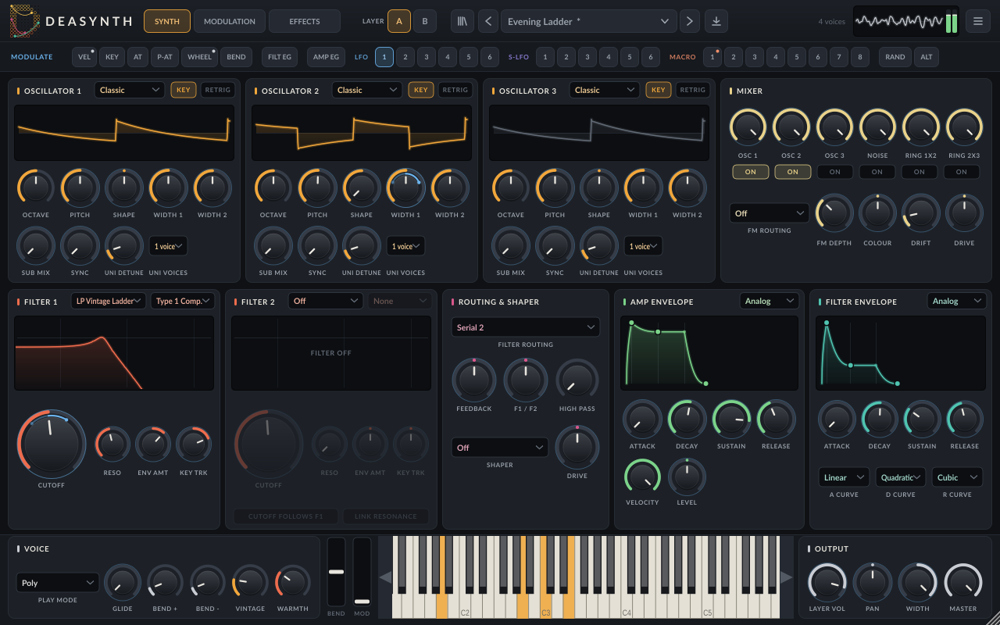
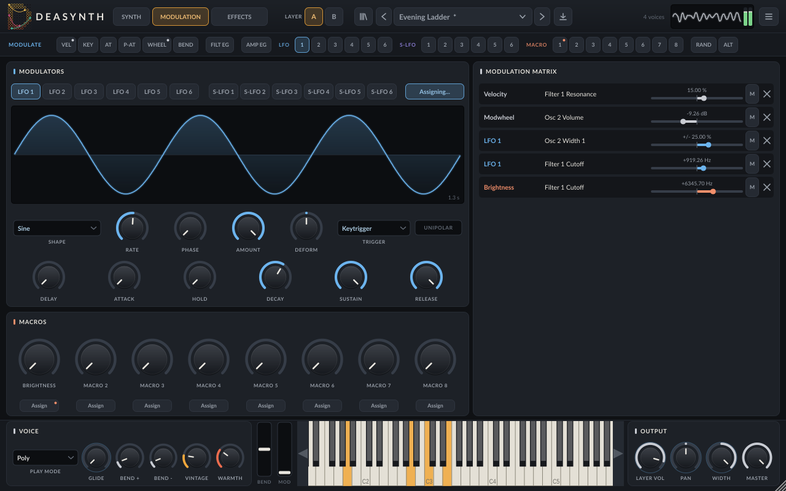
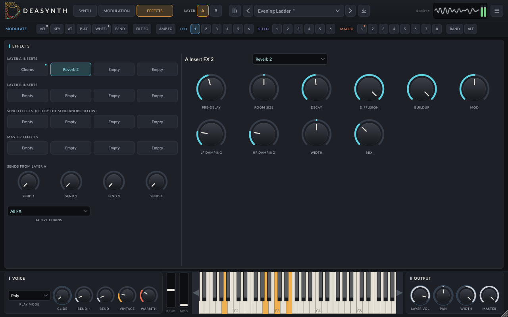

# Deasynth

Deasynth is a synthesizer with its own interface, built on the Surge XT engine in this
repository. It builds as a standalone application and as a plugin:

| Platform | Formats |
|----------|---------|
| macOS    | Standalone app, Audio Unit (Logic Pro, GarageBand, MainStage), VST3 |
| Linux, Windows | Standalone app, VST3 |



Surge XT itself is untouched: Deasynth is an additional target (`src/deasynth`) that links the
same engine library (`surge-common`). Both can be built from one checkout and installed side
by side; they keep separate settings, patches and plugin identities.

* [Building and installing on a Mac](#building-and-installing-on-a-mac)
* [Signing and notarization](#signing-and-notarization)
* [Using it](#using-it)
* [What is new, and what is the engine's](#what-is-new-and-what-is-the-engines)
* [How the code is laid out](#how-the-code-is-laid-out)
* [The logo](#the-logo)
* [Tests](#tests)
* [Licence and names](#licence-and-names)

## Building and installing on a Mac

You need Xcode (or its command line tools), CMake, and optionally Ninja:

```bash
xcode-select --install
```

```bash
brew install cmake ninja
```

Then, from the repository:

```bash
scripts/deasynth/build-mac.sh --install
```

That one command fetches the submodules if needed, builds a universal (Apple silicon and
Intel) app, Audio Unit and VST3, runs the self-test, signs the bundles, installs them for
your user account together with the factory patches and wavetables, and runs Apple's Audio
Unit validator (`auval -v aumu Deas Eldr`). A first build takes a while; later ones are
incremental.

| Installed to | |
|---|---|
| `/Applications/Deasynth.app` | the standalone app |
| `~/Library/Audio/Plug-Ins/Components/Deasynth.component` | the Audio Unit |
| `~/Library/Audio/Plug-Ins/VST3/Deasynth.vst3` | the VST3 |
| `~/Library/Application Support/Deasynth` | factory patches, wavetables, effect presets |
| `~/Documents/Deasynth` | your own patches and settings (created on first run) |

In Logic Pro, add a Software Instrument track and choose **AU Instruments > Eldrin >
Deasynth** in the instrument slot. If it is not listed, restart Logic, or use **Logic Pro >
Settings > Plug-in Manager > Reset & Rescan Selection**.

Useful options: `--native` builds only for the Mac you are on (about twice as fast),
`--debug` builds a debug configuration, `--clean` starts from scratch. `--help` lists them
all. Without `--install` the script only builds and tells you where the products are.

Deasynth runs without the factory content, with an empty patch browser. To install or
refresh only the content, run `scripts/deasynth/install-content.sh`.

On Linux, the equivalent is:

```bash
cmake -S . -B build -G Ninja -DCMAKE_BUILD_TYPE=Release
```

```bash
cmake --build build --target deasynth_Standalone deasynth_VST3
```

```bash
scripts/deasynth/install-content.sh
```

## Signing and notarization

The identifiers are set in `src/deasynth/CMakeLists.txt`:

| | |
|---|---|
| Bundle identifier | `com.eldrin.deasynth` (the plugins get `.component` / `.vst3` variants from JUCE) |
| Team ID | `H7CJSVP2JC` |
| Audio Unit | type `aumu`, subtype `Deas`, manufacturer `Eldr` |

`build-mac.sh` signs with the best identity it finds in your login keychain, in this order:

1. a **Developer ID Application** certificate for team `H7CJSVP2JC`, with the hardened
   runtime and a secure timestamp. This is what you want for giving Deasynth to other people;
2. an **Apple Development** certificate;
3. an ad-hoc signature. This is all a Mac needs to run something it built itself, so you can
   use Deasynth in Logic on your own machine without any certificate at all.

Set `DEASYNTH_SIGN_IDENTITY` to choose one explicitly.

To notarize, so that a copy downloaded on another Mac opens without Gatekeeper objecting,
you need the Developer ID certificate in your keychain and a stored `notarytool` profile.
Create the profile once:

```bash
xcrun notarytool store-credentials deasynth-notary --apple-id YOUR_APPLE_ID --team-id H7CJSVP2JC
```

It will ask for an app-specific password (made at appleid.apple.com) and keep it in your
keychain. Then:

```bash
scripts/deasynth/build-mac.sh --notarize
```

The stapled, zipped products are left in `build-deasynth/dist`. No credentials are stored in
this repository or needed by its CI; signing happens only on your Mac with your keychain.

The `Deasynth` GitHub Actions workflow builds the same products on every push and uploads
them as an artifact. Those are ad-hoc signed, so macOS will quarantine a downloaded copy;
build locally, or notarize, for anything you intend to run.

## Using it

The panel reads left to right in the order the sound is made, and each stage has its own
colour, used for its knobs, its display and its modulation rings.

**Header.** Three pages (Synth, Modulation, Effects); the layer switch (Deasynth holds two
complete layers, A and B: right-click the switch to split or stack them); the patch
controls; an oscilloscope and level meter; and the menu.

**Choosing patches.** Click the patch name for a drop-down of categories, each opening onto
its patches; third party libraries are grouped by author and your own patches are under My
patches. The arrows either side of the name step to the previous and next patch. The
bookshelf button opens the browser, which adds search across everything: there, the up and
down arrow keys (and Page Up / Page Down) move through the list and load each patch as you
go, Return closes the browser on the one you are on, and Escape closes it too. The
arrow-into-tray button saves.

**Modulate strip.** Every modulation source: velocity, key tracking, aftertouch, wheels, the
two envelopes, six voice LFOs, six scene LFOs, eight macros, random and alternate. A dot on a
source means it is in use.

To modulate something: click a source to arm it, and every knob it can reach gets a halo.
Drag a knob and a ring in the source's colour shows how far the source will move it. Click
the source again (or press Escape) to finish. Double-click a knob while armed to remove that
routing. Right-click a source to clear everything it does.

**Synth page.** Three oscillators with a live picture of what each is producing (twelve
algorithms: classic analog shapes, wavetable, FM, string model, and more; click the picture
of a wavetable oscillator to choose a table). The mixer, with ring modulators, noise, FM and
**Drive**, which is the level into the filters. Two filters with their measured frequency
response, their routing, feedback and a waveshaper. Amp and filter envelopes.



**Modulation page.** The LFO editor (shapes include a 16-step sequencer you draw with the
mouse), the macros (right-click one to rename it), and the modulation matrix, which lists
every routing in the layer with its depth, a mute and a remove button.



**Effects page.** Sixteen slots in four chains: inserts for each layer, sends, and master.
Click a slot to edit it, right-click to bypass it.

**Bottom.** Play mode, glide, bend range, the two character controls, wheels, keyboard and
output.

The displays are controls too: drag on a filter curve to move cutoff (left and right) and
resonance (up and down), and drag an envelope's handles to set its times and sustain level.

Every knob: drag to turn (hold Shift for fine), double-click to reset, right-click for a
menu to type a value, sync a time to tempo, extend a range or remove modulation. Hovering
shows the value in place of the label and in the header.

## What is new, and what is the engine's

It is worth being exact about this.

**The engine's (Surge XT).** All oscillators, both envelope types, LFOs, the effects, patch
format, MPE and tuning support, and the filter models. That already includes the designs
this project set out to feature: the *Vintage Ladder* is a transistor ladder in the Moog
tradition (two published models, with and without gain compensation), there is a *Diode
Ladder*, a *K35* Sallen-Key pair, state variable and OB-Xd filters. The filter feedback path,
oscillator drift, and the capacitor-style *Analog* envelope mode are also the engine's.
Deasynth's contribution here is to put them in front: the init patch is a sawtooth through
the ladder with analog envelopes, drift on and the feedback path available, and Drive and
Feedback are first-class knobs rather than menu items.

**New in this repository.**

* *Vintage* (`src/common/dsp/SurgeVoice.cpp`, `SurgeStorage::vintageAmount`). Each voice draws
  its own random pitch offset (up to 12 cents) and cutoff offset (up to 4 semitones) when it
  starts, the way the voice cards of a vintage polysynth each sit slightly differently. The
  response is squared so the first half of the knob is subtle. It is an engine change, off by
  default, so Surge XT behaves exactly as before.
* *Warmth* (`src/deasynth/dsp/AnalogStage.h`). An output stage: asymmetric soft saturation
  (even and odd harmonics) with low-frequency pre-emphasis, run at twice the sample rate
  between half-band filters, then DC blocked. At zero it is bypassed and bit-transparent.
* *Product identity* (`SurgeStorage::productIdentity()`), so a product built on the engine
  keeps its data, documents and preferences in its own folders.
* The whole interface and plugin wrapper under `src/deasynth`.

Vintage and Warmth belong to the instrument rather than to a patch: they are saved with your
Logic project and can be automated, but loading a patch does not change them. Patches are
ordinary Surge XT `.fxp` files, so the Surge XT factory and third-party libraries load in
Deasynth, and Deasynth patches load in Surge XT.

**Not in the interface yet.** The engine has more than the panel shows. The MSEG and Formula
modulator shapes can be selected and play, but their editors are not built; nor are the
wavetable script editor, microtuning, MIDI learn, the effect preset menus, audio input, or
OSC. Patches that use these still load and sound right.

## How the code is laid out

```
src/deasynth/
  DeasynthProcessor.*     juce::AudioProcessor: owns the engine, MIDI, host parameters, state
  dsp/AnalogStage.h       the Warmth output stage
  gui/Theme.*             palette, fonts, look and feel
  gui/Widgets.*           ParamControl (knob / selector / switch for any engine parameter),
                          ValueKnob, FlatButton, Section
  gui/Displays.*          oscillator, filter response, envelope, LFO, step and scope displays
  gui/Panels.*            the sections: oscillators, mixer, filters, envelopes, LFOs, macros,
                          modulation matrix, effects, voice, output
  gui/Overlays.*          modulate strip, patch browser, save dialog, wheels, about
  gui/DeasynthEditor.*    the window: layout, pages, the refresh timer
  tests/selftest.cpp      self-test
  tests/presetgen.cpp     writes the starter patches in resources/deasynth/patches
```

Three ideas carry most of it:

* **One control for every parameter.** `ParamControl` binds to an engine `Parameter` and draws
  itself from what that parameter currently is, so when an oscillator or effect changes
  algorithm its controls change name, range and even kind (knob, selector, switch) without
  the panel being rebuilt. Names, value text and type-in parsing all come from the engine.
* **Displays use the engine's own DSP.** The oscillator display runs a real oscillator, the
  filter display measures the real filter, the LFO display runs a real LFO. Each fingerprints
  the parameters it depends on and recomputes only when the fingerprint changes. (The
  envelope display is the exception: it is drawn from the stage times and levels.)
* **Polling, not callbacks.** A 30 Hz timer asks each visible control whether what it shows
  is stale. That covers host automation, patch loads and MIDI in one path. When no audio
  callback is running the same timer performs the engine's deferred work (patch loads,
  algorithm swaps), as Surge XT's editor does.

The window is designed at 1280 x 800 and scaled as a whole, so it resizes freely with a fixed
aspect ratio.

## The logo

`resources/deasynth/DeasynthLogo.svg` is the logo. Two things are made from it:

* `resources/deasynth/DeasynthMark.svg`, the same artwork without the background tile. It is
  embedded in the plugin and drawn in the header and the About panel, so the interface shows
  the logo on a transparent background at any window size.
* `resources/deasynth/DeasynthIcon.png`, the app icon, which keeps the tile. Regenerate it
  with `scripts/deasynth/render-icon.sh` after changing the logo.

To change the logo, replace `DeasynthLogo.svg`, make the matching `DeasynthMark.svg` (delete
the background `<rect>` and, if you like, tighten the `viewBox` to the artwork), run
`render-icon.sh`, and rebuild.

## Tests

```bash
cmake --build build --target deasynth-selftest && build/deasynth-selftest
```

checks the audio path (including odd host buffer sizes), that Warmth is transparent at zero,
bounded and DC-free at full, that Vintage is exact at zero and within its limits at full,
session state round trips, that damaged or truncated state is rejected without disturbing
the loaded sound, the host parameter list, and that every editor page builds and paints.
Pass a directory to have it write a snapshot of each page there; the pictures in this
document are made that way.

`deasynth-selftest --write-patches resources/deasynth/patches` regenerates the starter
patches and fails if any is silent or clips.

## Licence and names

Deasynth is a derivative of Surge XT and is therefore released under the GNU General Public
License, version 3 or later, like the rest of this repository. If you distribute Deasynth
binaries you must make the corresponding source available under the same licence and keep
the existing copyright notices. That is compatible with signing and notarizing with your
Apple Developer ID; it is not compatible with Mac App Store distribution terms.

The interface was designed from scratch. It follows general practices that hardware and
software synthesizers share (signal-flow layout, one colour per section, live displays) but
does not copy the artwork, panel designs or names of any other manufacturer's product, and
no third-party product names appear in it. "Surge XT" is the name of the upstream project
and is used here only to credit it.
